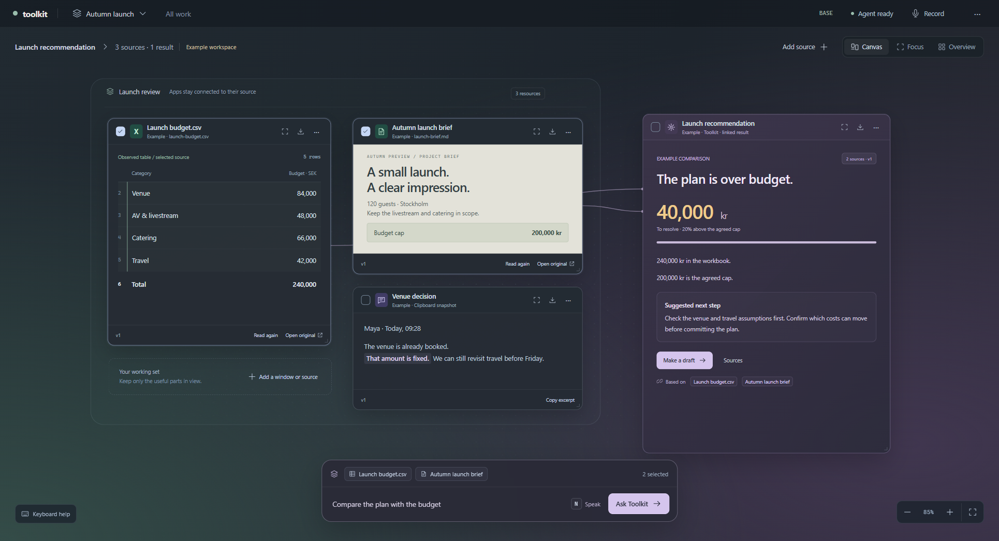
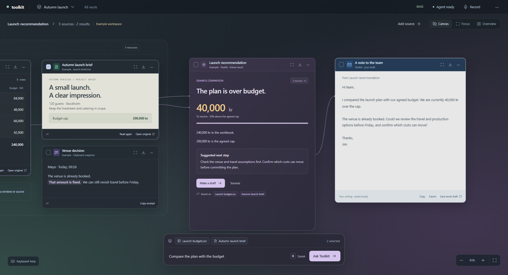

# Canvas presentation and Qt ownership

The desktop canvas renders the connected-work sketch's HTML and CSS in Qt
WebEngine. `assistant/canvas_assets/canvas.css` retains the sketch's visual
rules; `shell.css` adapts them to a full native window and real saved content.
The canvas uses the same grouped sources, warm document, lilac result, connecting
lines, compact top bar, and floating two-row composer as the design study.

The previous Qt widget approximation is no longer the application's canvas.
Qt still owns native windows, hotkeys, file dialogs, the Windows appbar, and
renderer lifetime. History, Work, notifications, keyboard views, and keeper
controls use Qt widgets. Tkinter, `_tkinter`, Tcl/Tk DLLs, IDLE, and Turtle are
excluded from the bundled interpreter.

## Appearance and interaction

The screenshots below use an explicitly labeled local example workspace.
Its CSV and Markdown sources are actual bundled files; the example comparison
is labeled sample content. It is available from the workspace menu without
replacing an existing workspace.

The page owns card layout, dragging, resizing, pan, zoom, focus, overview,
selection, launcher search, and editing. A validated QWebChannel boundary routes
commands to `CanvasController`, which owns immutable state and persistence.
Native resource reads and draft saves run off the UI thread. Result updates
preserve the actual editor DOM node, text, selection, and undo history.

`All work` can pin completed work without resubmitting it. Meeting workspaces
project the existing verified package: transcripts, notes with exact source
passages, actions, and full unsent drafts. Editing uses the existing meeting
workflow and its saved revision numbers, including generated revision zero.
An enqueue acknowledgement never appears as a successful save.

## Runtime boundary

The local page cannot navigate to arbitrary files or remote pages. Its resource
interceptor and content security policy restrict loading to bundled assets and
Qt's web-channel script. Source text and agent output cannot inject HTML.
External links and original resources pass through typed native adapters.
Consequential approval previews still open in the existing native Work review.

The Windows dependency lock includes PySide6 Addons and WebEngine, with the
matching `QtWebEngineProcess.exe` renderer helper. The bundler permits that
specific helper while excluding unrelated wheel executables.

The assistant owns QApplication, its WebEngine views, pages, channels, and
profile on Python's main thread. Pages are destroyed before their profile.
Closing restores desktop effects, stops resource work and mail handoffs, and
flushes canvas persistence. The Windows control window retains its separate
message thread; keyboard processing remains isolated.

## Verification

`tests/test_canvas_web_contract.py` covers malformed commands, geometry, safe
Markdown, source snapshots, approval routing, and exact mail receipts.
`tests/test_windows_canvas_web.py` runs the real Chromium view with isolated
storage and checks the reference layout, pointer dragging and resizing,
selected-source submission, focus and modal behavior, editor preservation,
reopening, meeting edits, and native cleanup. Runtime checks exercise fresh
process startup and shutdown. The release is also compared visually on Windows;
the previous widget implementation's test results do not validate this renderer.
